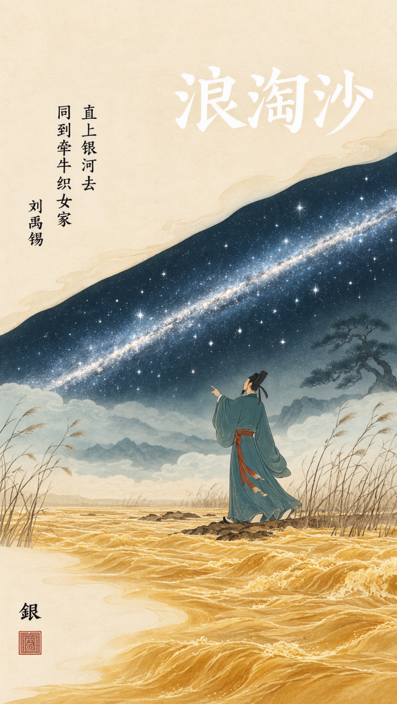

# 生成示例

本目录存放使用本 skill 生成的海报示例，展示「AI 一次性直出完整海报」的实际效果——插画、标题、诗句、作者署名与朱印全部由模型在同一张图中直接生成。

## 示例列表

### 1. 《浪淘沙·其一》· 刘禹锡（唐）

**入画诗句**：直上银河去，同到牵牛织女家

**核心意象**：黄河、银河、唐代文人、芦苇古松

**情绪氛围**：豪放浪漫——沙涛被浪淘上银河，与织女为邻

### 2. 《如梦令·昨夜雨疏风骤》· 李清照（宋）

**入画诗句**：昨夜雨疏风骤，浓睡不消残酒。试问卷帘人，却道海棠依旧。知否，知否？应是绿肥红瘦。

**核心意象**：海棠花（红瘦绿肥）、薄帘半卷、慵懒女仕

**情绪氛围**：惜春婉约——慵懒中见细腻

## 生成方式

- **后端**：ComfyUI + MOSS-Image（Flux2 底座）
- **分辨率**：832×1472（9:16 竖版）
- **关键参数**：`steps: 50`, `cfg: 3.0`, `sampler: euler`, `scheduler: beta`
- **提示词前缀**：`moss_xvstyle,`
- **文字准确性技巧**：提示词末尾列出逐字清单，要求笔画完整、结构正确

完整提示词见各诗词目录下的 `prompt.md`（或参考 `references/poster-prompt-template.md` 模板）。
